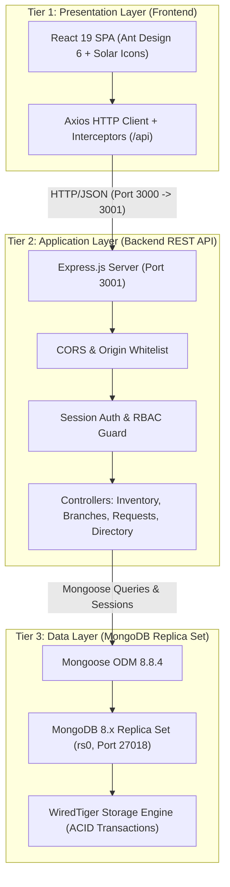

# ASHCOL Multi-Branch HVAC Inventory & Service Fleet Management System
### Technical Project Documentation
**Course**: INF242 — Integrative Programming and Technologies  
**Institution**: National University Mall of Asia (NU MOA) — School of Information Technology  
**Submission Deadline**: October 19, 2026, at 11:59 PM  
**Submission Portal**: [INF242 Submission Link](https://nationalueduph-my.sharepoint.com/:f:/g/personal/matgipit_nu-moa_edu_ph/IgD7w7odFO8bSZqqwCskUXj4AUWBcFfyKwZLQhaHyVOFt4Q?e=3sZx96)  

---

## Page 1: Title & Group Information

* **Project Title**: ASHCOL Multi-Branch HVAC Inventory & Service Fleet Management System
* **Course Code & Title**: INF242 — Integrative Programming and Technologies
* **Academic Term**: 1st Term, A.Y. 2026–2027
* **Faculty Instructors**: Mr. Mark Anthony Gipit & Mr. Androi Pamisaran
* **IT Program Chair**: Ms. Emilyn A. Donor
* **Dean**: Ms. Marilou N. Jamis
* **Submission Date**: October 19, 2026

### Group Members & Roles

| Member Name | Student ID | Role / Contribution Area |
| :--- | :--- | :--- |
| **Dizon, [First Name]** | [Student ID] | Full-Stack Lead, Architecture & Database Design |
| **[Group Member 2]** | [Student ID] | Backend API Development & Transaction Logic |
| **[Group Member 3]** | [Student ID] | Frontend UI/UX (React & Ant Design) Implementation |
| **[Group Member 4]** | [Student ID] | Technical Documentation & Quality Assurance Testing |

---

## Page 2: Table of Contents

```text
TABLE OF CONTENTS
---------------------------------------------------------------------------------
1. PROJECT OVERVIEW, SCOPE, SYSTEM ARCHITECTURE, AND DATABASE DESIGN ............ Page 3
   1.1 Project Overview & Problem Statement
   1.2 System Scope & Objectives
   1.3 System Architecture (Three-Tier MERN Architecture)
   1.4 Database Schema Design & Data Structures
   1.5 Multi-Document Transaction & Replica Set Requirements

2. USER INTERFACE DESIGN & SCREENSHOTS .......................................... Page 4
   2.1 UI/UX Design Philosophy & Component System
   2.2 Authentication & Role-Based Navigation Flow
   2.3 Multi-Branch & Fleet Inventory Dashboard
   2.4 Stock Ledger & Post-Movement Workflow
   2.5 Material Requests & Fulfillment Workflow

3. FEATURE LIST BREAKDOWN ....................................................... Page 5
   3.1 User Authentication & Role-Based Access Control (RBAC)
   3.2 Multi-Branch & Mobile Service Van Fleet Management
   3.3 HVAC Catalog & Inventory Tracking
   3.4 Immutable Stock Movement Auditing
   3.5 Material Request & Multi-Stage Approval Pipeline
   3.6 Supplier Directory & Brand Registry
   3.7 Data Integrity, Input Sanitization & Atomic Transactions

4. SUMMARY & FUTURE WORK ........................................................ Page 6
   4.1 Project Summary
   4.2 Future Enhancement Features

5. SOURCES & REFERENCES ......................................................... Page 7
   5.1 Libraries, Frameworks & Dependencies
   5.2 Documentation & Technical References

6. APPENDIX: VIDEO DEMONSTRATION & PRESENTATION SCRIPT .......................... Page 8
   6.1 Video Presentation Requirements & Checklist
   6.2 Three-Tier Presentation Breakdown
```

---

## Page 3: Project Overview, Scope, System Architecture, and Database Design

### 1.1 Project Overview & Problem Statement
ASHCOL Airconditioning Services specializes in HVAC installations, commercial repairs, scheduled preventive maintenance, and spare parts supply across Metro Manila. Prior to this system, parts tracking was siloed into single-warehouse spreadsheets, leading to discrepancies, unrecorded material dispatches to service vans, phantom stock, and delayed repairs due to missing copper pipes or capacitors.

The **ASHCOL Multi-Branch HVAC Inventory & Service Fleet Management System** is a production-grade full-stack web application developed on the **MERN** stack (MongoDB, Express.js, React 19, Node.js). It introduces multi-branch partition scoping, mobile warehouse tracking for field service vans, immutable stock movement auditing, and an end-to-end material requisition workflow with atomic multi-document database transactions.

### 1.2 System Objectives & Scope
* **Centralized HVAC Catalog**: Standardize stock items (split-type AC units, copper tubes, freon cylinders, capacitors, brackets) with enforce unit-of-measure constraints (`SET`, `UNIT`, `ROLL`, `CYL`, `PCS`, `METER`).
* **Multi-Branch & Mobile Fleet Scoping**: Manage stationary hubs (e.g., `LOCAL-WAREHOUSE`, `BRANCH-NORTH`) and mobile service vans (`VAN-01`, `VAN-02`) as first-class inventory locations.
* **Strict Role-Based Access Control (RBAC)**: Enforce distinct authority tiers for `ADMIN`, `MANAGER`, and `EMPLOYEE` accounts across branch boundaries.
* **Material Request Lifecycle**: Support employee requisition, managerial review (Approve/Deny), and atomic fulfillment that deducts stock and writes audit records in a single database transaction.
* **Legacy Data Migration & Resilience**: Provide tools to extract, migrate, and validate legacy archives (`ashcol_inventory.dump`) into relational-equivalent document collections without stock drift.

### 1.3 System Architecture (Three-Tier MERN Architecture)



### 1.4 Database Schema Design & Data Structures
The database is structured in MongoDB under the `ashcol_inventory` database. All collections enforce strict schema validation via Mongoose:

1. **`branches` Collection**:
   * `_id` (`String`): Identifier (e.g., `"LOCAL-WAREHOUSE"`, `"BRANCH-NORTH"`, `"VAN-01"`).
   * `name` (`String`, required): Formal facility name or vehicle label.
   * `branchType` (`String`, enum: `["WAREHOUSE", "SERVICE_VAN"]`).
   * `plateNumber`, `driverId`, `driverName` (`String`): Fleet tracking fields.
   * `status` (`String`, enum: `["AVAILABLE", "ON_FIELD", "ARRIVED", "MAINTENANCE"]`).

2. **`products` Collection**:
   * `_id` (`ObjectId`): Unique item identifier.
   * `branchId` (`String`, indexed): Branch owning this stock allocation.
   * `sku` (`String`, indexed, uppercase): Item SKU code (e.g., `DAIK-1.0HP-INV`).
   * `name` (`String`, required): Product model or description.
   * `itemType` (`String`, enum: `["AC Unit", "Material / Part", "Spare Part", "Consumable", "Tool / Equipment"]`).
   * `category` (`String`), `brand` (`String`), `capacity` (`String`).
   * `brandId` (`ObjectId`, optional ref: `Brand`) and `supplierId` (`ObjectId`, optional ref: `Supplier`); name fields remain display snapshots.
   * `unitOfMeasure` (`String`, enum: `["UNIT", "PCS", "METER", "FOOT", "KG", "LITER", "ROLL", "CYLINDER", "CYL", "PAIR", "CAN", "SET"]`).
   * `unitCost` (`Number`, min 0), `listPrice` (`Number`, min 0).
   * `quantity` (`Number`, min 0): Current live stock level.
   * `reorderLevel` (`Number`, min 0): Minimum stock threshold before alert.
   * `archived` (`Boolean`, default: `false`).
   * **Compound Index**: `{ branchId: 1, sku: 1 }` (Unique compound index preventing duplicate SKUs per branch).

3. **`stock_movements` Collection (Immutable Audit Ledger)**:
   * `_id` (`ObjectId`): Movement transaction ID.
   * `productId` (`ObjectId`, ref: `Product`): Linked product reference.
   * `branchId` (`String`): Branch where the movement occurred.
   * `sku`, `itemName`, `unitOfMeasure` (`String`).
   * `movementType` (`String`, enum: `["DELIVERY", "DISPATCH", "RETURN", "CORRECTION", "TRANSFER_IN", "TRANSFER_OUT", "REQUEST_FULFILLMENT"]`).
   * `quantityDelta` (`Number`): Positive for stock additions, negative for deductions.
   * `beforeQuantity`, `afterQuantity` (`Number`): Quantities before and after the transaction.
   * `reason`, `referenceNumber`, `jobNumber`, `referenceId` (`String`): External reference and readable job number.
   * `jobId` (`ObjectId`, optional ref: `JobOrder`): Linked service job.
   * `performedBy` (`String`), `performedByName` (`String`): Identity of actor.
   * `createdAt` (`Date`): Timestamp.

4. **`partrequests` Collection**:
   * `_id` (`ObjectId`): Request ID.
   * `branchId` (`String`): Originating branch/service van.
   * `productId` (`ObjectId`, ref: `Product`), `sku`, `itemName`, `unitOfMeasure` (`String`).
   * `requestNumber` (`String`, unique): Material request number.
   * `jobId` (`ObjectId`, optional ref: `JobOrder`), `jobNumber` (`String` snapshot): Optional linked job.
   * `quantityNeeded` (`Number`, min > 0): Quantity requested.
   * `status` (`String`, enum: `["PENDING", "APPROVED", "DENIED", "FULFILLED"]`).
   * `requestedBy`, `requestedByName`, `reviewedByName`, `decisionReason`, `fulfilledByName`.

5. **`users` & `sessions` Collections**:
   * `email` (`String`, unique, lowercase), `fullName`, `role` (`ADMIN`, `MANAGER`, `EMPLOYEE`), `branchId`.
   * Passwords secured via cryptographic PBKDF2 hashing (`crypto.pbkdf2Sync`).
   * Sessions stored with SHA-256 token hashing and MongoDB TTL auto-expiry indexes.

### 1.5 Multi-Document Transaction Requirements
Unlike traditional educational CRUD apps, stock mutations in ASHCOL (transfers, dispatches, requisitions) require **ACID transactions**:
* MongoDB is initialized in **Replica Set mode** (`rs0`) on port `27018`.
* Whenever a movement is recorded, Mongoose initiates a session (`conn.startSession()`) and executes `session.withTransaction()`.
* If a stock deduction results in negative stock, or if an audit record fails to save, the entire transaction rolls back cleanly, preventing phantom stock.

---

## Page 4: User Interface Design & Screenshots

### 2.1 UI/UX Design Philosophy
The frontend is constructed using **React 19** with **Ant Design 6** component framework, stylized with an enterprise industrial aesthetic matching ASHCOL's corporate identity (Navy `#0A2540`, Slate `#F4F6F8`, Teal `#00D4B2`, and Warning Gold `#F5A623`).

* **Responsive Layout**: Fluid flex and grid layouts adjusting dynamically across desktop monitors, warehouse tablets, and field technician mobile devices.
* **Micro-Interactions**: Real-time validation feedbacks, Ant Design notification modals, loading skeletons, and interactive metric cards.

### 2.2 Key Screen Layouts & Workflows

1. **Sign-In View (`/login`)**:
   * Clean card layout with corporate branding, email/password validation, credential persistence via session storage, and security alerts for invalid tokens.
   
2. **Executive Inventory Dashboard (`/dashboard`)**:
   * **KPI Metrics**: Total Active SKUs, Low Stock Items (at or below reorder level), Total Inventory Valuation (stored `unitCost × quantity`), and Total Potential Retail Value (`listPrice × quantity`).
   * **Branch Selector**: Dropdown to toggle view between All Branches (Admin only) or a specific service facility/van.
   * **Filter Bar**: Search by SKU or Name, Filter by HVAC Item Type, Brand, and Stock Status.

3. **Master Catalog & Stock Table (`/inventory`)**:
   * Ant Design Table featuring paginated records, color-coded stock tags (`In Stock`, `Low Stock`, `Out of Stock`, `Archived`), inline action buttons (`Edit`, `Adjust Stock`, `Archive`, `View History`).
   * Modal dialog for **Item Registration / Update** featuring dynamic capacity inputs, unit-of-measure constraints, and initial cost history tracking.

4. **Post Movement & Transfer Modal (`/post-movement`)**:
   * Interactive modal with tabbed operations:
     * **Receive Delivery**: Record vendor shipments with Invoice/DR number.
     * **Direct Dispatch**: Record materials used on job orders.
     * **Inter-Branch Transfer**: Select Source Branch, Destination Branch, SKU, and Quantity; atomic commit updates both branches simultaneously.
     * **Inventory Correction**: Adjust discrepancies with a mandatory audit rationale.

5. **Material Requests Board (`/requests`)**:
   * Status-tabbed requisition board (`All`, `Pending`, `Approved`, `Denied`, `Fulfilled`).
   * Employees view request status and submission modal; Managers and Admins view approval/rejection action buttons with reason dialogs and a 1-click **Fulfill & Deduct Stock** button.

6. **Service Vans & Fleet Directory (`/service-vans`)**:
   * Mobile warehouse overview showcasing van plate numbers, assigned drivers, operation status (`AVAILABLE`, `ON_FIELD`, `MAINTENANCE`), and live onboard spare part counts.

---

## Page 5: Feature List Breakdown

### 3.1 Authentication & Role-Based Access Control (RBAC)
* **PBKDF2 Password Encryption**: Cryptographic salt-and-hash storage preventing plaintext credential exposure.
* **Token-Based Session Management**: Stateful session tokens with cryptographic hashing and automated expiration.
* **Hierarchical Role Permissions**:
  * **`ADMIN`**: Global access to all branches, account creation, branch registration, fleet commissioning, cross-branch transfers, and system overrides.
  * **`MANAGER`**: Management of assigned branch catalog, movement postings, requisition reviews, and stock fulfillments.
  * **`EMPLOYEE`**: Read-only access to branch catalog and ledger; submission of job order material requests.

### 3.2 HVAC-Specific Inventory Management
* **Unit of Measure Enforcement**: Strict quantity validation based on unit type (e.g., `SET`, `UNIT`, `PCS`, `CYL` strictly enforce integer counts; `METER`, `FOOT`, `KG` permit up to 3 decimal places).
* **Automated Low-Stock Calculations**: Dynamic calculation of available stock subtracting approved (reserved) material requests:
  $$\text{Available Stock} = \text{Current Stock} - \text{Reserved Quantities}$$
* **Soft Archival System**: Items with zero quantity and no open requests can be safely archived and unarchived, preserving historical ledger associations.

### 3.3 Immutable Stock Ledger & Auditing
* **Double-Entry Historical Log**: Every stock mutation records `beforeQuantity`, `afterQuantity`, delta, actor ID, actor full name, and timestamp.
* **External Reference Linking**: Enforces work order numbers (`AC-XXXX`), delivery receipts, or transfer tracking numbers on every transaction.
* **Ledger Export**: Filter and inspect chronological movement trails per SKU or per facility.

### 3.4 Multi-Branch & Service Van Fleet Architecture
* **Virtual Branch Partitions**: Segregates inventory databases logically per physical warehouse or mobile service vehicle.
* **Van Fleet Status Tracking**: Real-time dispatch status (`AVAILABLE`, `ON_FIELD`, `MAINTENANCE`) paired with driver assignments.
* **Atomic Inter-Branch Stock Transfers**: Simultaneous deduction from source branch and addition to destination branch wrapped inside a single MongoDB session transaction.

### 3.5 Material Request Pipeline
* **Requisition Submission**: Technicians request specific parts against a customer work order number.
* **Managerial Review**: Managers approve requests (which flags inventory as reserved without deducting physical stock) or deny with explanation.
* **Atomic One-Click Fulfillment**: Fulfilling an approved request automatically posts a `REQUEST_FULFILLMENT` movement and deducts physical stock.

### 3.6 Auxiliary Registries
* **Brand Registry**: Centralized brand directory (Carrier, Daikin, Panasonic, Kolin, Samsung, Mitsubishi, etc.).
* **Supplier Directory**: Vendor contact details, payment terms (`30 Days Net`, `COD`), and corporate addresses.

---

## Page 6: Summary & Future Work

### 4.1 Project Summary
The **ASHCOL Multi-Branch HVAC Inventory & Service Fleet Management System** successfully addresses the operational bottlenecks of HVAC contracting businesses. By applying integrative programming concepts and full-stack software engineering principles, the system achieves:
1. **Zero Stock Discrepancy**: Eliminated ghost inventory through atomic transactions and strict unit validations.
2. **Operational Accountability**: Full visibility over materials dispatched to mobile technician vans.
3. **Resilient Data Architecture**: Seamless recovery and migration of legacy database archives (`ashcol_inventory.dump`) into a modern MERN structure.
4. **Intuitive User Experience**: An enterprise-ready interface allowing technicians, managers, and directors to interact smoothly across desktop and mobile devices.

### 4.2 Future Work & Planned Enhancements
* **GPS Fleet Integration**: Real-time geolocation tracking for service vans on active field service calls, updating status automatically based on geofencing.
* **Mobile Barcode & QR Code Scanner**: Native camera integration in the React app allowing warehouse personnel to scan item barcodes and technician toolboxes during dispatches.
* **Automated Supplier Purchase Order (PO) Generation**: Automatic generation and PDF emailing of reorder purchase orders to suppliers (e.g., Daikin, Carrier) when stock falls below configured reorder levels.
* **Offline-First PWA Support**: Progressive Web App service-worker caching allowing field technicians to view van stock and draft requisitions in basements or areas without cellular coverage.
* **Predictive Inventory Analytics**: Machine learning models forecasting summer seasonal demand spikes for refrigerant gases and inverter split-type units.

---

## Page 7: Sources, Libraries, and References

### 5.1 Technology Stack & Dependencies

#### Frontend (Presentation Tier)
* **React 19.3.0**: Core component framework and virtual DOM engine.
* **Ant Design (antd) 6.6.5**: Enterprise UI component library (tables, modals, forms, notifications).
* **@ant-design/icons & @solar-icons/react 2.3.2**: Vector UI iconography.
* **Axios 1.20.0**: Promise-based HTTP client for RESTful API communication.
* **React Scripts 5.0.1**: Development server, Webpack bundler, and build toolchain.

#### Backend (Application Tier)
* **Node.js (v26.x)**: Asynchronous event-driven server runtime environment.
* **Express.js 4.21.2**: Backend web application framework for RESTful routing and middleware.
* **Mongoose 8.8.4**: Object Data Modeling (ODM) library for MongoDB validation, schemas, and transactions.
* **CORS 2.8.5**: Cross-Origin Resource Sharing middleware.
* **dotenv 16.4.5**: Environment variable configuration management.
* **Node.js Crypto Module**: Native cryptographic hashing (PBKDF2, SHA-256) and UUID generation.

#### Database (Data Tier)
* **MongoDB Server 8.3**: Document-oriented NoSQL database with WiredTiger storage engine.
* **MongoDB Database Tools 100.19.1**: Official utilities (`mongorestore`, `mongodump`, `mongoexport`, `bsondump`).

### 5.2 Technical Documentation & Guides
1. **MongoDB Manual**: Multi-Document ACID Transactions in Replica Sets — [https://www.mongodb.com/docs/manual/core/transactions/](https://www.mongodb.com/docs/manual/core/transactions/)
2. **Express.js Documentation**: Routing, Error Handling, and Middleware Architecture — [https://expressjs.com/](https://expressjs.com/)
3. **React 19 Documentation**: Modern React Hooks, State Management, and Lifecycle — [https://react.dev/](https://react.dev/)
4. **Ant Design Documentation**: Components, Tokens, and Responsive Form Patterns — [https://ant.design/](https://ant.design/)
5. **OWASP Top Ten**: Authentication and Access Control Best Practices — [https://owasp.org/www-project-top-ten/](https://owasp.org/www-project-top-ten/)

---

## Page 8: Appendix — Video Demonstration & Presentation Script

### 6.1 Presentation Guidelines Checklist
* [x] **Camera Requirement**: All group members presenting must have their webcams turned on with their faces clearly visible during their respective parts.
* [x] **Duration**: 8 to 12 minutes total presentation length.
* [x] **Three Tiers Covered**: Database (Tier 3), Backend (Tier 2), and Frontend (Tier 1) clearly demonstrated.
* [x] **Accessibility**: Video uploaded to SharePoint / OneDrive with "Anyone with the link can view" permission enabled.

### 6.2 Video Presentation Script Outline

```text
================================================================================
VIDEO PRESENTATION STRUCTURE & TIMELINE
================================================================================

[00:00 - 01:30] PART 1: INTRODUCTION & PROJECT MOTIVATION (Speaker 1)
- Welcome and group member introductions (faces on camera).
- Real-world problem: HVAC contractors struggle with tracking parts across central 
  warehouses and mobile service vans, resulting in lost stock and job delays.
- System Overview: Introduction of the ASHCOL Multi-Branch HVAC Inventory System.

[01:30 - 04:00] PART 2: DATABASE TIER & SCHEMA DESIGN (Speaker 2)
- Demonstration of MongoDB Compass / mongosh connected to port 27018.
- Explanation of Replica Set rs0 requirement for ACID transactions.
- Walkthrough of core schemas: Products, Branches, Stock Movements, Part Requests.
- Explanation of compound unique indexes ({ branchId: 1, sku: 1 }) and data integrity.
- Demonstration of dump archive extraction (ashcol_inventory.dump) and migration script.

[04:00 - 06:30] PART 3: BACKEND ARCHITECTURE & RESTFUL APIS (Speaker 3)
- Explanation of Express server structure (app.js, setup.js, routes).
- Security walkthrough: PBKDF2 password hashing and token-based session verification.
- Live API Demonstration using Postman or terminal curl:
  - POST /api/auth/login
  - GET /api/products
  - POST /api/products/:id/stock (Highlighting session.withTransaction rollback safety).
- Error handling demonstration: Validation errors (e.g. invalid unit decimals) and CORS guard.

[06:30 - 09:30] PART 4: FRONTEND UI & INTERACTIVE WORKFLOWS (Speaker 4 / All)
- Live React application walkthrough on http://localhost:3000.
- Login as Admin Master (hatdog@hat.com):
  - Dashboard KPI cards: Valuation, low stock warnings, branch switcher.
  - Catalog management: Adding a new split-type AC with SET units.
  - Inter-branch transfer: Transferring copper tubes from Main Warehouse to Van-01.
- Role-based testing: Sign in as Field Technician:
  - Restricted permissions (No direct stock adjustments).
  - Submitting a Material Request for job AC-1049.
- Switch to Manager account:
  - Approving the material request and clicking "Fulfill" to trigger atomic stock deduction.
- Audit Trail: Inspecting the Movements Ledger to show the immutable audit entry.

[09:30 - 10:30] PART 5: SUMMARY, FUTURE ENHANCEMENTS & CONCLUSION (Speaker 1)
- Summary of learning outcomes achieved (MERN integration, transactions, UX design).
- Future roadmap: GPS tracking, Barcode scanning, and automated PO generation.
- Closing remarks and acknowledgments to faculty (Mr. Gipit & Mr. Pamisaran).
================================================================================
```
